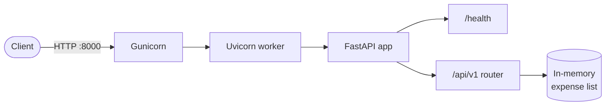

<div align="center">

# 💸 devops-portfolio

**A tiny expense-tracker API, built step by step with real DevOps practices.**

Final project for the **CDS212 DevOps** module at **FH Graubünden**.
The project grows every week with a new DevOps topic: testing, CI/CD, containers and more.

[](https://www.python.org/)
[](https://fastapi.tiangolo.com/)
[](https://docs.astral.sh/uv/)
[](https://docs.pytest.org/)
[](#-docker)
[](LICENSE)

[Features](#-features) ·
[Quick start](#-quick-start) ·
[API](#-api) ·
[Testing](#-testing) ·
[Docker](#-docker) ·
[Roadmap](#-roadmap)

</div>

---

## ✨ Features

- 📝 **Track expenses** with a description, amount, category and date
- ✅ **Validation built in**: Pydantic rejects missing fields and non-positive amounts
- 📊 **Stats endpoint** with count, total and per-category breakdown
- ❤️ **Health check** for container orchestration
- 🐳 **Multi-stage Docker image** that runs as a non-root user under Gunicorn + Uvicorn
- 📖 **Interactive API docs** at `/docs`, generated by FastAPI

## 🏗️ Architecture



> **Note:** expenses currently live in memory, so they reset on restart.
> A proper repository layer is on the [roadmap](#-roadmap).

## 📁 Project structure

```text
devops-portfolio/
├── app/
│   ├── routes/
│   │   ├── routes.py        # FastAPI app, models and endpoints
│   │   └── repository.py    # future persistence layer
│   └── tests/
│       └── test_stats.py    # unit + API tests
├── Dockerfile               # multi-stage, non-root production image
├── pyproject.toml           # project metadata and dependencies
└── uv.lock                  # pinned dependency versions
```

## 🚀 Quick start

**Prerequisites:** Python 3.10+, [uv](https://docs.astral.sh/uv/), Git (and Docker, if you want the container).

```bash
git clone https://github.com/thukiy/devops-portfolio.git
cd devops-portfolio

uv sync                                            # install dependencies
uv run uvicorn app.routes.routes:app --reload      # start the dev server
```

Then open **<http://localhost:8000/docs>** for the interactive Swagger UI.

## 🔌 API

| Method | Endpoint                 | Description                      | Success |
| :----: | ------------------------ | -------------------------------- | :-----: |
| `GET`  | `/health`                | Liveness check                   | `200`   |
| `GET`  | `/api/v1/expenses`       | List all expenses                | `200`   |
| `POST` | `/api/v1/expenses`       | Add an expense                   | `201`   |
| `GET`  | `/api/v1/expenses/stats` | Count, total and category totals | `200`   |

<details>
<summary><b>Example requests</b></summary>

**Add an expense**

```bash
curl -X POST http://localhost:8000/api/v1/expenses \
  -H "Content-Type: application/json" \
  -d '{"description": "Groceries", "amount": 42.9, "category": "food", "date": "2026-10-30"}'
```

```json
{ "description": "Groceries", "amount": 42.9, "category": "food", "date": "2026-10-30" }
```

**Get stats**

```bash
curl http://localhost:8000/api/v1/expenses/stats
```

```json
{ "count": 2, "total": 23.4, "by_category": { "food": 15, "transport": 8.4 } }
```

**Invalid input** (`amount` must be greater than 0) returns `422 Unprocessable Entity`.

</details>

## 🧪 Testing

```bash
uv run pytest                          # run the test suite
uv run pytest --cov=app --cov-report=term-missing   # with coverage
```

The tests cover the `Stats` calculations (including floating-point rounding),
the full add-and-list flow, input validation and the health endpoint.

## 🐳 Docker

```bash
docker build -t devops-portfolio .
docker run --rm -p 8000:8000 devops-portfolio
```

What the image does:

| | |
| --- | --- |
| 🧱 **Multi-stage build** | Dependencies are installed in a builder stage; only the venv is copied into the runtime image |
| ⚡ **Layer caching** | `pyproject.toml` and `uv.lock` are copied first, so dependencies are only reinstalled when they change |
| 🔒 **Non-root user** | The app runs as `appuser` (UID 1000) |
| ❤️ **Healthcheck** | Docker polls `/health` every 30 seconds |
| 🏭 **Production server** | Gunicorn manages Uvicorn workers |

## 🗺️ Roadmap

- [x] Python project setup
- [x] FastAPI expense endpoints
- [x] Unit and API tests with pytest
- [x] Dockerfile
- [ ] Persistence via a repository layer
- [ ] CI pipeline with GitHub Actions
- [ ] Container registry and deployment

## 📄 License

Released under the [MIT License](LICENSE).

<div align="center">

Made with ☕ by [Thuvaraka Yogarajah](https://github.com/thukiy) · FH Graubünden

</div>
