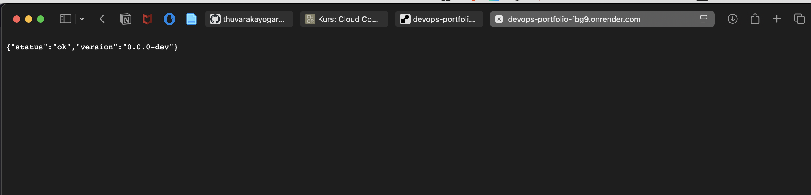

<!--
  Hinweis zur Erstellung: Bei der Überarbeitung dieses Runbooks wurde KI
  (Claude, Anthropic) als Hilfsmittel eingesetzt – für Review, Hinweise auf
  Lücken sowie Formatierungs- und Strukturkorrekturen. Inhalte, Werte und
  Befehle wurden von der Autorin am eigenen Setup geprüft.
-->

# Deployment-Runbook – Expense Tracker auf Render (Free Tier)

Diese Deployment-Dokumentation beschreibt die Schritte, um die Anwendung `expense-tracker` (Ordner `ausgabenverwaltung`) in der Zielumgebung Render (Free Tier) zu deployen. Sie dient als Leitfaden für Entwickler und DevOps-Teams, um eine konsistente und reproduzierbare Bereitstellung sicherzustellen.

**Live-Instanz:** https://devops-portfolio-fbg9.onrender.com

**Platzhalter in diesem Dokument:**

| Platzhalter | Bedeutung | Beispiel |
|---|---|---|
| `<APP_URL>` | Öffentliche URL des Render-Services (ohne `https://`) | `devops-portfolio-fbg9.onrender.com` |
| `<ID>` | ID einer Ausgabe aus der Antwort von `POST /api/expenses` | `1` |

## A. Voraussetzungen

- Konten: GitHub-Konto, Render-Konto (Free, Anmeldung mit GitHub).
- Lokale Werkzeuge (mit Prüfbefehl):
  ```bash
  git --version      # erwartet: git version 2.x
  python3 --version  # erwartet: Python 3.12.x (pyproject.toml verlangt requires-python >= 3.12)
  curl --version     # erwartet: curl 7.x oder 8.x
  ```
  Ist die Python-Version älter als 3.12, zuerst Python 3.12 installieren (macOS: `brew install python@3.12`) und in Teil B `python3.12` statt `python3` verwenden.
- Zugriff/Rechte: Lesezugriff auf das Repository `thuvarakayogarajah/devops-portfolio`; für das Deployment ein Render-Konto, dem Zugriff auf dieses Repository gewährt wurde.

## B. Lokale Installation

```bash
git clone https://github.com/thuvarakayogarajah/devops-portfolio.git
cd devops-portfolio/ausgabenverwaltung
python3 -m venv .venv && source .venv/bin/activate
pip install -r requirements-dev.txt
make run
```

Erwartete Ausgabe im ersten Terminal (der Prozess läuft weiter, Terminal offen lassen):

```
 * Running on http://127.0.0.1:8000
```

In einem **zweiten Terminal**:

```bash
curl http://127.0.0.1:8000/health
# erwartet: {"status":"ok","version":"0.0.0-dev"}
```

Lokal ist keine `APP_VERSION` gesetzt, daher erscheint der Standardwert `0.0.0-dev`. Den Server im ersten Terminal mit `Ctrl+C` beenden.

## C. Konfigurationsvariablen

| Variable | Standard | Geheim | Wirkung |
|---|---|---|---|
| `DATABASE_URL` | *(leer)* | ja | leer ⇒ In-Memory-Speicher (nicht persistent); gesetzt ⇒ PostgreSQL |
| `APP_VERSION` | `0.0.0-dev` | nein | Versionsanzeige in `/health` und `/metrics`; bei jedem Release erhöhen |
| `LOG_LEVEL` | `INFO` | nein | Log-Schwelle (`DEBUG`, `INFO`, `WARNING`, `ERROR`) |
| `PORT` | `10000` (Render-Vorgabe) | nein | Port, an den Render den Traffic leitet; **muss auf `8000` gesetzt werden**, weil der Container auf 8000 hört |
| `GUNICORN_WORKERS` | `1` | nein | Anzahl Gunicorn-Worker; ohne Datenbank **zwingend 1** |

**Geheime Werte** (hier: `DATABASE_URL`) gehören nie ins Repository und nie in dieses Dokument. Auf Render werden sie im Service unter **Environment → Environment Variables** eingetragen. Lokal setzt man sie nur in der aktuellen Terminal-Sitzung, z. B. mit `export DATABASE_URL=...`. Eine allfällige `.env`-Datei ist in `.gitignore` eingetragen und darf nicht committet werden.

## D. Deployment-Schritte (Render)

**Hauptpfad: Render-Dashboard.** (Ein Blueprint/`render.yaml` wird nicht verwendet.)

### D1. Einmalige Einrichtung – Web Service anlegen

1. Auf https://dashboard.render.com anmelden (mit GitHub).
2. Oben rechts auf **New** → **Web Service** klicken.
3. Als Git Provider **GitHub** wählen und das Repository `thuvarakayogarajah/devops-portfolio` auswählen. Erscheint es nicht in der Liste: **Configure GitHub App** klicken und Render Zugriff auf das Repository geben.
4. Auf **Connect** klicken.

### D2. Service konfigurieren

5. Folgende Felder setzen:

   | Feld | Wert |
   |---|---|
   | Name | `devops-portfolio` |
   | Language | `Docker` |
   | Branch | `main` |
   | Region | `Frankfurt (EU Central)` |
   | Root Directory | `ausgabenverwaltung` |
   | Instance Type | `Free` |

6. Unter **Advanced** → **Health Check Path**: `/health` eintragen (nicht `/ready`, siehe Teil G).
7. Unter **Environment Variables** folgende Variablen hinzufügen:

   | Key | Value |
   |---|---|
   | `PORT` | `8000` |
   | `APP_VERSION` | `1.0.0` |
   | `LOG_LEVEL` | `INFO` |
   | `GUNICORN_WORKERS` | `1` |

   `DATABASE_URL` wird **nicht** gesetzt (In-Memory-Betrieb).

### D3. Erstmaliges Deployment auslösen

8. Auf **Deploy Web Service** klicken.
9. Im Log (Service → **Logs**) den Fortschritt verfolgen. Nach dem Docker-Build erscheinen u. a.:
   ```
   Listening at: http://0.0.0.0:8000 (1)
   ==> Your service is live 🎉
   ```
10. Die öffentliche URL (`https://<APP_URL>`) steht oben im Service-Dashboard unter dem Service-Namen.

### D4. Wiederkehrendes Deployment

Jeder Push auf den Branch `main` löst automatisch ein neues Deployment aus (Auto-Deploy). Vor einem Release `APP_VERSION` unter **Environment** erhöhen, damit der neue Stand in `/health` sichtbar ist. Manuell: **Manual Deploy** → **Deploy latest commit**.

## E. Verifikation nach dem Deploy

**Hinweis Cold Start:** Im Free Tier schläft der Service nach 15 Minuten ohne Aufrufe ein. Der erste Aufruf kann dann 30–60 Sekunden dauern. Das ist kein Ausfall.

**1. Health Check**

```bash
curl -i https://<APP_URL>/health
# erwartet: HTTP/2 200
#           {"status":"ok","version":"1.0.0"}
```

Screenshot der laufenden Instanz:



**2. Smoke-Test der API** (Anlegen → Lesen → Löschen)

```bash
curl -i -X POST https://<APP_URL>/api/expenses \
  -H "Content-Type: application/json" \
  -d '{"amount":"12.50","category":"food","date":"2026-11-28"}'
# erwartet: HTTP/2 201 und JSON mit "id", z. B. "id": 1
```

Den Wert von `"id"` aus der Antwort als `<ID>` in den nächsten Befehlen einsetzen:

```bash
curl -i https://<APP_URL>/api/expenses/<ID>
# erwartet: HTTP/2 200 und dieselbe Ausgabe als JSON

curl -i -X DELETE https://<APP_URL>/api/expenses/<ID>
# erwartet: HTTP/2 204 (leere Antwort)
```

Erlaubte Kategorien: `food`, `housing`, `transport`, `leisure`, `other`.

**3. Log prüfen**

Im Render-Dashboard unter Service → **Logs** erscheinen die Aufrufe von oben als Access-Log-Zeilen, z. B.:

```
"GET /health HTTP/1.1" 200
"POST /api/expenses HTTP/1.1" 201
```

Es dürfen keine Fehlermeldungen (`Traceback`, `ERROR`) und keine geheimen Werte im Log stehen.

## F. Rollback

1. Im Render-Dashboard den Service `devops-portfolio` öffnen → Reiter **Events**.
2. Den letzten **erfolgreichen** Deploy vor dem fehlerhaften auswählen → **Rollback** klicken → bestätigen.
3. Warten, bis im Log wieder `==> Your service is live 🎉` erscheint.
4. Prüfen, ob **Auto-Deploy** nach dem Rollback noch aktiv ist (Service → **Settings**), und es nach Behebung des Fehlers ggf. wieder einschalten.

**Verifikation:** Schritte aus Teil E wiederholen. `/health` muss wieder die `APP_VERSION` des vorherigen Releases anzeigen (z. B. `1.0.0` statt der fehlerhaften neueren Version).

**Grenzen:** Ein Rollback setzt nur den Code bzw. das Image zurück, nicht die Daten. Eine angebundene Datenbank rollt nicht mit zurück; Schemaänderungen müssen manuell rückgängig gemacht werden. Ohne Datenbank gehen die gespeicherten Ausgaben bei jedem Deploy, Rollback und Cold Start verloren, da der In-Memory-Speicher nicht persistent ist.

## G. Troubleshooting

| Symptom | Ursache | Lösung |
|---|---|---|
| Deploy hängt, Log zeigt „No open ports detected" | Render erwartet Port 10000, der Container hört auf 8000 | Unter **Environment** `PORT=8000` setzen und neu deployen |
| Deploy wird nie „live", Health Check schlägt fehl | Health Check Path steht auf `/ready`; ohne Datenbank antwortet `/ready` nicht erfolgreich | Unter **Settings → Health Check Path** auf `/health` umstellen |
| Erster Aufruf dauert 30–60 s oder läuft in einen Timeout | Cold Start: Free-Tier-Service schläft nach 15 min Inaktivität | Kein Ausfall; kurz warten und erneut aufrufen |
| `GET`/`DELETE /api/expenses/<ID>` liefert zufällig `404`, obwohl die Ausgabe gerade angelegt wurde | Mehrere Gunicorn-Worker ohne Datenbank: jeder Worker hat seinen eigenen In-Memory-Speicher | `GUNICORN_WORKERS=1` setzen oder eine Datenbank (`DATABASE_URL`) anbinden |
| `POST /api/expenses` liefert `400` mit Fehlermeldung | Ungültige Eingabe, z. B. Kategorie nicht erlaubt oder Datum nicht im Format `JJJJ-MM-TT` | Erlaubte Kategorie verwenden (siehe Teil E) und Datum als `2026-11-28` angeben |

## H. Kontakt und Eskalation

- **Service-Owner:** Thuvaraka Yogarajah (Entwicklung und Betrieb)
- **Kommunikationsweg:** GitHub Issues im Repository `thuvarakayogarajah/devops-portfolio`
- **Eskalation:** Ist ein Problem nach **30 Minuten** nicht gelöst, Eskalation an `<DevOps-Lead / Kursleitung – Name, Kontakt>`
